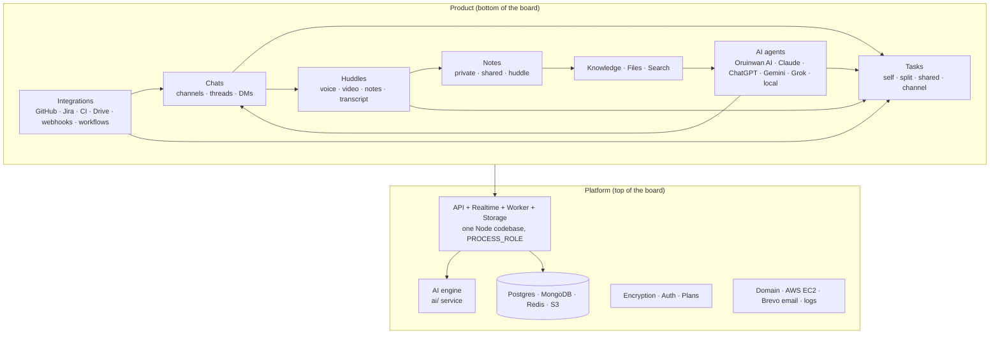
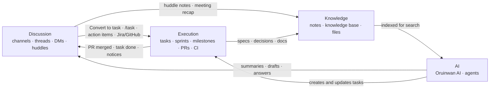

# Oruinwan product map

How every part of Oruinwan connects, what is built today, and where the gaps are. It follows the
whiteboard: the **bottom half** is what people see and use (the product), the **top half** is what
runs underneath (platform, services, security, future upgrades).

Paths are relative to the repository root. "Gap" means something a user would expect that is
missing or only half built. Gaps are collected and ranked in [section 5](#5-gaps-ranked).

Companion doc: [TEAM_WALKTHROUGH.md](TEAM_WALKTHROUGH.md) walks a 5-person team through all of it.

---

## Contents

1. [The big picture](#1-the-big-picture)
2. [Product: what people use](#2-product-what-people-use)
3. [How the pieces link: discussion → execution → knowledge → AI](#3-how-the-pieces-link)
4. [Platform: what runs underneath](#4-platform-what-runs-underneath)
5. [Gaps, ranked](#5-gaps-ranked)
6. [Upgrade path: from one box to a distributed system](#6-upgrade-path)

---

## 1. The big picture

**Apps.** Web (React 19, `client/`), desktop (Electron, `desktop/`, loads the same web UI), Android
phone and tablet (Capacitor, `mobile/`, its own UI code). iPhone and iPad use the web app. Every app
talks to one server.

**Accounts.** Individuals sign up free and create workspaces. Companies register separately and get a
company console with departments, roles and audit logs (no plan limits).

---

## 2. Product: what people use

Navigation (desktop): the left icon rail (`client/src/components/layout/IconSidebar.jsx`) has
**Home, Channels, Messages, Tasks, Notes, Huddles, Agents & tools**, then Settings. Tasks, Notes and
Huddles can be switched off per workspace (Workspace admin → Features).

### 2.1 Chats: channels, threads, DMs

| Part | What exists | Where |
|---|---|---|
| Channels | Public or private, description, member picker, pins, polls, reminders, saved messages, mute, canvases (up to 5 per channel), tabs **Chat · Threads · Tasks · Canvas** | `client/src/features/messaging/`, `server/src/features/channels/channel.model.js` |
| Threads | Reply in thread, follow, resolve (✓ Resolved), summarize thread with AI | `server/src/modules/threads/` |
| DMs | One-to-one only (the model requires exactly 2 people) | `server/models/DMSession.js` |
| Messages | Encrypted on the device, mentions, reactions, attachments, forward, translate, edit history, delete for me/everyone, **Convert to task**, **Review code with AI** | `server/src/modules/messages/message.model.js`, `MessageToolbarParts.jsx` |
| Slash commands | `/call /video /meet /poll /code /shrug /ai /task`, plus with integrations `/github /review /jira /zoom /gmeet /gitlab /bitbucket /linear /drive /onedrive /dropbox /notion /confluence` | `client/src/components/chat/slash/slashCommands.js` |

Gaps: **group DMs** are advertised on the landing page but do not exist; message text search only
finds system and bot messages because messages are encrypted.

### 2.2 Tasks

Create from **Tasks → New task**, from a message (**Convert to task**), with `/task`, from a huddle,
from a meeting action item, from Jira, or from an automation.

| Assign to (UI) | What happens | Code |
|---|---|---|
| **Me** (self) | One private task for you | `assignmentType: 'self'` |
| **Members**, mode **Split** | Each person gets their own copy with its own key | `taskMode: 'split'` |
| **Members**, mode **Shared** | One task, everyone assigned | `taskMode: 'shared'` |
| **Full channel** | One task visible to the channel; posts New/Completed notices there | `assignmentType: 'channel'` |

Views: List, Board, Sprint, Timeline, Workload; side panel My tasks, Incoming, Given, All, Completed,
Trash; Planning (Milestones, Time report, Design reviews, Templates). Statuses: Backlog, To do,
In progress, In review, Blocked (needs a reason), Done, Cancelled. Data: Mongo `server/models/Task.js`
or Postgres `0005_tasks.sql` when `TASKS_STORE=pg`.

Links that work: message → task (`linkedMessage`, message shows "☑ Task"); PR / Jira issue → task
(`externalLinks`, status sync); task → milestone / sprint / roadmap item.

Gaps: the "☑ Task" chip on a message does not open the task, and the task page never shows the
message it came from; split copies are not grouped (no way to see "the 5 copies of this task");
only channel-visibility tasks post to the channel; task attachments are links only.

### 2.3 Notes

| Kind | How |
|---|---|
| Private (self) | Default for a new note |
| Shared | **Share** → Workspace (everyone can view) or named people with View/Edit |
| Huddle notes | Created for each huddle, shared with everyone in the call, with an **Action items** checklist that converts to tasks |
| Canvases | Live inside a channel (a separate store from notes) |

Templates: Blank, Project spec, Tech design, Brainstorm, Meeting notes, SOP, Announcement, Document.
Live co-editing with presence (Yjs). Data: Mongo `server/models/Note.js`.

Gaps: "allow comments" is stored but there are no note comments; note groups live in the browser
only (not synced); no "share note to channel" or "note from message"; canvases and notes are two
separate systems.

### 2.4 Huddles and meetings

Start from a channel or DM header, `/call` `/video`, or **Huddles → Start a huddle / Video huddle /
Schedule** (tabs Live now · Upcoming · Past). Voice and video with screen share and raise hand. Each
meeting has one page before, during and after the call: agenda, notes, recording, live transcript
and captions, and an AI recap from the transcript (`server/src/features/meetings/`,
`server/src/modules/huddles/`).

Calls are **peer-to-peer (WebRTC mesh)**: every person sends their audio/video to every other
person. That is fine up to about 5–8 people; bigger calls need a media server (SFU).

Since 2.2: every call opens a full call screen that minimises to a floating mini call (and to its
own always-on-top window in the desktop app); one call per person (a second one asks Stay/Switch);
"Move here" moves a live call between your own devices with a short pause; Android has video, a
background call notification and permission prompts. Protocol: [api/calls.md](api/calls.md).
Remaining gaps: screen sharing from an Android phone; seamless moves and big calls need an SFU.

### 2.5 AI agents

| Agent | How it is added | Used by |
|---|---|---|
| **Oruinwan AI** | Built in, always on | Side panel ("Toggle Oruinwan AI"), `/ai`, `@ai`, summaries, drafts, translate, task extraction, meeting recaps, AI code review |
| Claude, ChatGPT, Gemini, Grok | Admin **Install for everyone** (workspace key) or member **Connect my own** (personal key) | DM the agent, or `@claude` `@chatgpt` `@gemini` `@grok` |
| Self-hosted model | `local_llm` (Ollama or any OpenAI-compatible server) | `@local` |

Find them under **Agents & tools → All agents → Directory**. The AI can act through 14 tools
(`ai/tools/registry.js`): read channels and members, send messages, create and update tasks, create
and list notes, search the workspace, schedule meetings, remember facts about you.

Gaps: no GitHub or Jira tools for the AI; Oruinwan AI defaults to a small local model, so quality
depends on what the server runs (the live server uses Anthropic).

### 2.6 Integrations, workflows, developer platform

Connect under **Settings → Integrations** (also **Agents & tools → Apps → Integration settings**).
The full guide is [integrations.md](integrations.md).

| Integration | Connects with | What it does |
|---|---|---|
| GitHub | Admin pastes a token; you add the webhook on GitHub | PR / review / push / check cards in chosen channels, PR ↔ task linking by key (`ABC-12`), status sync (PR opened → In review, merged → Done), code review drawer with AI review, `/github`, `/review` |
| Jira Cloud | Site + email + API token; webhook URL | New issue → task, Jira status → task status, `/jira` creates issues. **One-way** |
| GitLab, Bitbucket, Linear | Token + webhook | Cards, task linking, new issue → task |
| CI/CD (Actions, GitLab CI, Jenkins, CircleCI) | Webhook URL | Build status cards, automation trigger |
| Zoom, Google Meet | Credentials | `/zoom`, `/gmeet` create meeting links |
| Drive, OneDrive, Dropbox, Notion, Confluence | Tokens | File/page pickers, import pages into Knowledge |
| Slack, Teams | Bot token / webhook | Two-way bridge (outbound relayed by the sender's app, because of encryption) |
| Zapier, Make, n8n, incoming webhooks | URL with token | Post messages, create tasks, fire workflows |
| Outgoing webhooks | URL + events, signed `X-Oruinwan-Signature` | task.created / updated / completed, message.sent (metadata only) |

**Workflows** (**Agents & tools → Workflows**, admins only): trigger → conditions → actions.
Triggers: message sent, task created/completed, meeting completed, file uploaded, PR merged, webhook
received, schedule. Actions: send message, create/assign task, notify, call webhook, post to Slack,
trigger CI. Templates include "PR merged → post in #engineering" and "Meeting ended → action items".

**Developer platform** (**Agents & tools → Developer**): API keys (`chx_…`), public API
`/api/public/v1` (read messages metadata, tasks read/write, files, users, channels), outgoing
webhooks, bots, an app marketplace with review, and the JS SDK (`sdk/js`).

Gaps: Google Calendar and Gmail are missing; Jira is one-way; GitHub has no repo picker or automatic
webhook setup and reviews never go back to GitHub; bot tokens are created but never accepted, so
bots cannot post by themselves; the public API cannot post messages; the channel settings
"Integrations" tab is a mock; some marketplace apps ("Jira Bridge (two-way sync)", "Google Calendar
Sync", "Slack Mirror"…) are demo entries that do nothing.

### 2.7 Knowledge, files, search, activity

| Part | What exists | Gap |
|---|---|---|
| Knowledge base | Pages with categories, tags, backlinks, graph view, summaries, import from Notion/Drive (`server/src/features/knowledge/`) | No rail entry; notes cannot be promoted to knowledge |
| Files | Library with folders, versions, comments, permissions; design reviews start here | No rail entry; **files shared in chat never show in Files** |
| Design reviews | Rounds, reviewers, pinned annotations per version | Not linked to tasks or channels; not searchable |
| Roadmap | Items linked to milestones and tasks, by status or owner | Channel/project links exist on the server only |
| Search | Messages (system/bot only), files, people, channels, tasks, notes, knowledge; separate AI search | Skips reviews, roadmap, meetings; ⚠ restricted files may appear in search results for any member (needs checking) |
| Home / Activity | Unread conversations and mentions | A full activity feed is written on the server (tasks, notes, AI) but **no app reads it** |
| AI knowledge index | Notes, tasks and knowledge pages embedded into Postgres (pgvector) | Files and messages are not indexed; needs an embedding model configured |

### 2.8 Notifications and email

| Channel | Today |
|---|---|
| In-app (bell, Activity, toasts) | Server stores a notification for every DM message, mention, reaction, thread reply, task, huddle start, meeting reminder; sent live over the socket. The web app hides the toast for the chat you're looking at and groups bursts into "N new messages from X" (6-second window). |
| OS notifications | Desktop and browser notifications replace each other per conversation |
| Push (Android / iOS) | FCM / APNs, one per conversation (latest message, no count); skipped only when the person is active on the web |
| Email (Brevo) | Security emails (new-device sign-in, password changed, signed out everywhere) always; daily digest on by default; offline mention/DM email and task/meeting emails only when turned on |
| Preferences | Per workspace (messages, threads, tasks, meetings, AI, email, push), account (digest, mentions only, DMs, sound), per-conversation mute. "Do not disturb" is only a status; nothing obeys it. |

Since 2.2: nothing is created for a conversation you're reading on any device (web, desktop, phone,
split pane, open thread); one rolling notification per conversation counts up ("Ben · 5 new
messages") with push at most every 30 s; reading a chat clears its notifications everywhere; no
synthetic daily digest item; Do not disturb silences push and sounds. Email: sign-out keeps the
device id, so "new sign-in" emails are only for new devices (and can be turned off); the digest
defaults to Smart (daily only when something waited for you, otherwise weekly). Details:
[api/notifications.md](api/notifications.md).

---

## 3. How the pieces link

A team's work moves through four stages. Oruinwan is strongest when each stage feeds the next
without copy-paste.

| From → to | Works today | Missing |
|---|---|---|
| Message → task | Convert to task, `/task`, one task per message | Open the task from the message; show the message on the task |
| Thread → task / summary | Summarize thread, convert the root message | Convert a whole thread (all replies as context) |
| Huddle → notes → tasks | Shared huddle note, action items → tasks, AI recap | Recap posted back to the channel automatically (possible with a workflow) |
| PR / Jira → task | Key linking, status sync, issue → task | Task changes back to Jira; reviews back to GitHub |
| Task → channel | Notices for channel tasks; PR cards in threads | Notices for assigned/split tasks |
| Notes → knowledge | Separate systems, both indexed for AI | Promote a note to knowledge; share note to channel |
| Chat files → library | — | Chat attachments in Files |
| Everything → activity | Unread and mentions | Task, note, review and AI events in Home |
| Knowledge → AI | Notes, tasks, knowledge pages searchable by AI | Files; messages (encrypted, by design) |

**The three links that would make the biggest difference** (each is small):
1. Two-way message ↔ task link (open the task from the "☑ Task" chip, show the source message on the task).
2. Show the server's activity feed in Home, so task and note events appear next to messages.
3. Chat attachments appear in Files, so "where is that file?" has one answer.

---

## 4. Platform: what runs underneath

### 4.1 Processes

One Node codebase (`server/`), started in one of five roles (`server/src/shared/processRole.js`):

| Role | Does | Today |
|---|---|---|
| `api` | REST: auth, workspaces, tasks, notes, files metadata | All four roles run in **one process** (`all`) on the live server |
| `realtime` | Socket.IO: messages, presence, typing, huddle signalling | Redis adapter ready for more than one node |
| `worker` | Scheduled jobs, event outbox relay, webhook delivery | Redis lock so only one runs a job |
| `storage` | Uploads and downloads | Bytes stream through Node (no direct S3 links) |
| AI (`ai/`) | Orchestrator, agents, providers, tools | Runs inside the API process unless `AI_SERVICE_URL` is set |

Events: a producer writes its record and an `event_outbox` row in the same Postgres transaction →
the worker copies it to the Redis stream `oruinwan:events` → consumers (today: webhook delivery).
Notifications use a separate in-process emitter.

### 4.2 Data

| Store | Holds |
|---|---|
| **Postgres** (pgvector) | Identity (users, companies, workspaces, memberships, invites, sessions, devices), encryption key state, passkeys, plans, billing tables, event outbox, AI embeddings, tasks (when `TASKS_STORE=pg`), log mirror |
| **MongoDB** | Messages, threads, DMs, channels, notes, knowledge, notifications, activity, huddles, AI memory/usage, files metadata, automations, integrations, design reviews, audit logs (about 70 models) |
| **Redis** | Socket adapter, presence, job locks, event stream, sign-in approvals and QR codes, AI quota counters |
| **S3** (RustFS on the box) | Uploaded files |

The move from MongoDB to Postgres is about half done: identity is on Postgres, tasks can run on
either, logs are written to both. Running two primary databases costs memory and makes
cross-database writes non-atomic.

### 4.3 Security

| Area | Today | Gap |
|---|---|---|
| Message encryption | AES-256-GCM key per conversation, wrapped per member with their RSA identity key; keys live on the device | The server also keeps a copy of every conversation key (for AI and bots) and can unlock identity keys ("automatic unlock"), so whoever holds the server's key-encryption keys **and** the database can read messages. This is strong server-side encryption, not strict end-to-end. No forward secrecy. Keys sit in a plain `.env`, not a KMS. |
| Not encrypted | Notes, tasks, knowledge, files, metadata | Files at rest are not encrypted |
| Sign-in | Email + password, Google, passkeys, QR, SSO/SAML (flag); 2FA by authenticator, email code or approval from another device; device limit 4 | Rate limits are per process (in memory) |
| Tokens | 15-minute access JWT, 7-day rotating refresh token | — |
| Data rights | GDPR export/erase, legal hold, retention, audit logs, Drive backup | — |
| Database | Bound to localhost in Docker; Postgres TLS optional | Backups depend on the deploy script and EBS snapshots; nothing in the repo schedules them |

### 4.4 Operations

- **Hosting:** one AWS EC2 t3.micro (1 GB RAM) in ap-south-1 running Docker Compose (app, Postgres,
  MongoDB, Redis, RustFS) behind Caddy, at `oruinwan.poelys.com` / `api.oruinwan.poelys.com`.
  The marketing site and docs are on GitHub Pages. Apps are built and released by GitHub Actions.
- **Email:** Brevo (`server/utils/sendEmail.js`, SMTP fallback). Templates in
  `server/utils/emailTemplates*`. Security emails (new-device sign-in, password changed, signed out
  everywhere) cannot be turned off; the daily digest is on by default.
- **Logs and health:** pino JSON logs to Docker stdout; `GET /api/health` checks Mongo, Postgres and
  Redis. No metrics, tracing, error tracking or alerting.
- **Plans:** Free (limits in `server/src/shared/plans/plans.js`), Pro and Enterprise "coming soon",
  Company unlimited. No payment provider is connected yet.

---

## 5. Gaps, ranked

Ranked by how much they hurt a real team, not by size.

### Done in 2.2

| # | Gap | Why it matters |
|---|---|---|
| 1 | **Call screen**: a dedicated full call view on web, desktop and phone, minimise to a floating window and keep using the app | Calls feel like a status bar, not a call |
| 2 | **One huddle at a time per person**, and **move a live call between your own devices** | Prevents double-joining; laptop → phone without hanging up |
| 3 | **Notifications**: no alerts for the conversation you are looking at, group bursts from one person, stop flooding the activity centre | Today's flood trains people to ignore notifications |
| 4 | **Emails**: rate-limit the new-device email, sensible digest default, per-type controls | Same problem, by email |

### Linking (small changes, big effect)

5. Two-way message ↔ task link.
6. Activity feed in Home (task, note, review, AI events).
7. Chat attachments in Files; Files and Knowledge on the rail.
8. Notices for assigned and split tasks; group split copies.
9. Share note to channel, promote note to knowledge, note comments.

### Integrations

10. Bot tokens actually work (bots and apps can post), public API can post messages.
11. GitHub: repo picker and automatic webhook setup (OAuth app), post AI reviews back to GitHub.
12. Jira two-way (task status and comments back to Jira).
13. Google Calendar (huddles ↔ calendar) and Gmail.
14. Remove or finish the demo marketplace apps and the mock channel Integrations tab.

### Platform

15. Backups scheduled and tested; move off the 1 GB box (t3.small/medium or managed databases).
16. Finish one database (Postgres) or commit to MongoDB, not both.
17. Metrics, error tracking and alerts.
18. Encryption wording matches reality, or remove the server key copy for people who opt in to strict E2EE; move keys to AWS KMS.
19. Payment provider before Pro/Enterprise.
20. Group DMs (advertised, missing).

---

## 6. Upgrade path

Oruinwan is a **modular monolith** already designed to split. Go step by step; each step stands on
its own.

| Step | Change | Unlocks |
|---|---|---|
| 0 | Today: one process (`PROCESS_ROLE=all`), all databases on one 1 GB box | Fine for a few teams |
| 1 | Bigger box or managed data: RDS Postgres, MongoDB Atlas (or finish moving to Postgres), ElastiCache Redis, AWS S3 + CloudFront | Memory headroom, real backups, CDN for the web app and files |
| 2 | Split processes: one `worker`, then 2+ `api` and `realtime` behind a load balancer (sticky `/socket.io`), Redis stores for rate limits and AI memory | Restarts without downtime, 50+ person companies |
| 3 | AI as its own service (`AI_SERVICE_URL`), on a GPU or API-backed host | The first true microservice; it already has an HTTP contract |
| 4 | Media server (SFU such as LiveKit) + TURN for huddles | Calls above ~8 people, recording on the server, better mobile battery |
| 5 | Notifications and email as event consumers on the bus (Redis Streams → NATS JetStream if replay/fan-out is needed) | Batching, retries, per-user rules in one place |
| 6 | Per-tenant databases (`server/src/shared/tenantDb.js`, unused today) | Large companies with data-residency needs |

Observability (metrics, tracing, request IDs, alerts) should come in step 1, not last: you cannot
split what you cannot see.
